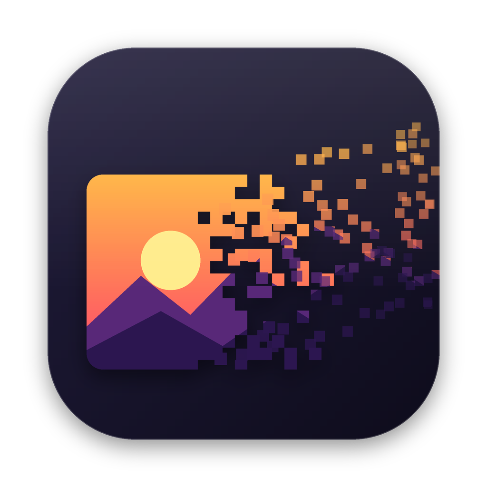
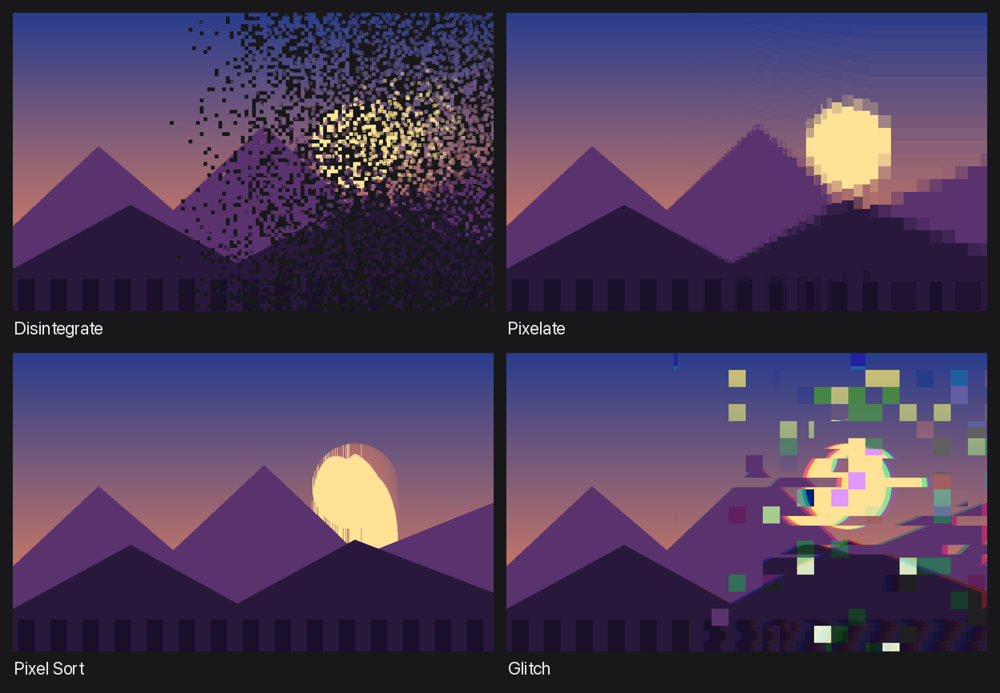

<p align="center">
  
</p>

<h1 align="center">Bitrot</h1>

<p align="center">
  A small macOS image editor for digital decay.<br>
  Paint where the picture should fall apart and choose how softly it does.
</p>

<p align="center">
  
</p>

## Features

- **Four effects**
  - **Disintegrate**: the image breaks into particles that drift away.
  - **Pixelate**: mosaic blocks that grow where the mask is stronger.
  - **Pixel Sort**: bright runs of pixels sorted into streaks.
  - **Glitch**: shifted scanlines, RGB split and broken blocks.
- **Masks**: apply an effect to part of the image with a brush, an eraser, a linear or radial gradient, a rectangle or an ellipse. Soft edges are adjustable.
- **Two transitions**
  - **Organic**: the mask drives the effect itself, so the edge breaks apart: fewer and smaller pieces, shorter streaks.
  - **Smooth**: the full effect fades into the original.
- **Layers**: stack several effects, each with its own mask.
- **Full-resolution export** to PNG (keeps transparency) or JPEG.
- **Native feel**: unified toolbar, SF Pro, light and dark mode, undo/redo, pinch to zoom.

## Install

You need macOS and a [Rust toolchain](https://rustup.rs) (1.85+).

```sh
git clone https://github.com/sarafanovn/bitrot.git
cd bitrot
./bundle.sh                          # builds target/Bitrot.app
cp -R target/Bitrot.app /Applications/
```

The app isn't signed. If macOS blocks it on first launch, right-click the app and choose **Open**.

To run without bundling:

```sh
cargo run --release -- path/to/image.jpg   # the path is optional
```

## Usage

1. Drop an image into the window or press **⌘O**. A Disintegrate layer is created for you.
2. Paint with the brush, or drag a gradient or shape over the part that should decay. The preview updates live.
3. Tweak the effect in the sidebar. Add more layers with **+**.
4. Press **⌘S** to export at full resolution.

| Shortcut | Action |
| --- | --- |
| B / E / G / M / L | Brush / Eraser / Gradient / Rectangle / Ellipse |
| [ and ] | Smaller / larger brush |
| ⌥ while dragging a shape | Subtract from the mask |
| Space + drag, two-finger scroll | Pan |
| Pinch, ⌘ + scroll | Zoom |
| ⌘0 | Fit to window |
| ⌘Z / ⇧⌘Z | Undo / Redo |
| ⌘O / ⌘S | Open / Export |

## How it works

The editor keeps a preview copy of the image (up to 1600 px on the long side), and masks are stored at that size too. A background thread re-renders the layer stack whenever something changes. Export renders the stack again on the original image, scaling the masks up and converting effect sizes from preview pixels to full-resolution pixels. The randomness is seeded per layer, so the export matches the preview.

| File | Contents |
| --- | --- |
| `src/effects.rs` | The four effects |
| `src/mask.rs` | Brush, shapes, gradients |
| `src/render.rs` | Layer compositing and the background renderer |
| `src/app.rs` | The UI |
| `src/theme.rs` | macOS styling and custom widgets |

The UI is built with [egui](https://github.com/emilk/egui). The icon is generated by `assets/make_icon.py` (needs Pillow).

## License

[MIT](LICENSE)
